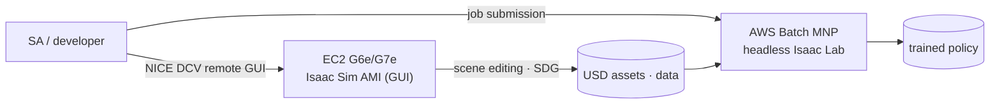
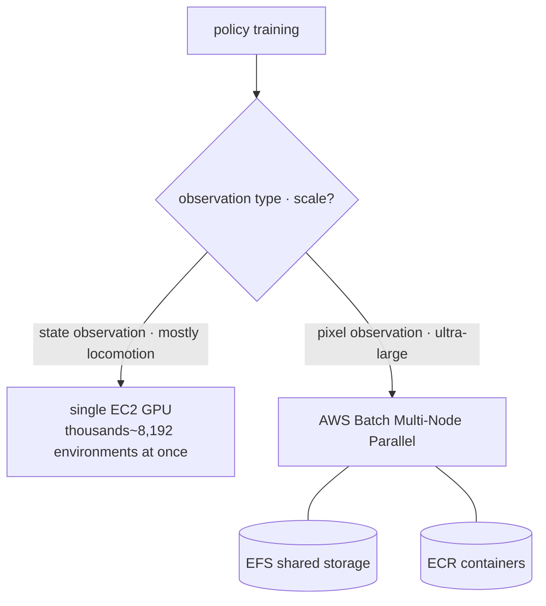
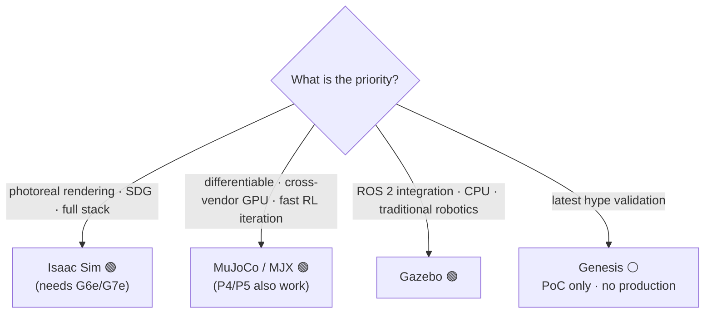

# Pillar 3 — Simulation

_Last updated: 2026-11 · owner: Youngjin · volatility: high (versions/instances change often)_
_Unless separately noted, each item inherits the page metadata (owner/updated/volatility). When an item has its own owner, add an item footer._
[← back to index](index.md)

> **L0 TL;DR**: Choose simulators and instances for rendering, observation type, and environment count. Use the [pinned execution path](execution.md#simulation) and [cost worksheet](start.md#roi). Service GA does not guarantee physical results on a customer task.

---

> **Review scope**: the page edit date does not revalidate every technical item. See [Evidence](evidence.md) for core corrections, check dates, and reproduction/human review status; legacy item dates still apply.

## Top 3 questions customers ask most in this pillar

> These are discovery examples, not a measured ranking of customer inquiries.

1. **"How do I run Isaac Sim/Lab on AWS? On which instances?"** → [Isaac on AWS](#1-isaac-sim--isaac-lab-on-aws--ga)
2. **"How do I scale thousands~tens of thousands of parallel RL environments in the cloud?"** → [Large-scale parallel RL](#2-large-scale-parallel-rl-simulation--ga)
3. **"Do I have to bet everything on NVIDIA? What about open-source alternatives?"** → [Open-source alternatives](#3-open-source-simulator-alternatives--ga---partly-hype), [decisions](decisions.md)

> **Stable principle (rarely changes)**: the value of simulation is (1) **parallelism** (thousands~8,000 environments at once on a single GPU)[^parallel], (2) **safety** (exploring risky policies without breaking real hardware), and (3) **automatic labeling** (perfect ground truth)[^gt] — and the **economics of physical robots** that converts these into money (one robot's price = tens of thousands of GPU hours) is item 6 below. Rendering **requires an RTX (RT Core)[^rtcore] GPU**, so A100/H100 (compute GPUs) cannot be used for Isaac Sim rendering — an invariant constraint that governs instance selection.

---

## 1. Isaac Sim & Isaac Lab on AWS  🟢 GA

**L0 TL;DR**: The canonical path to running NVIDIA Isaac Sim (simulator) + Isaac Lab (RL framework) on AWS EC2 GPUs. A **free AMI** in the Marketplace makes entry easy.

**Customer need/problem**: "A local workstation GPU isn't enough. I want to use Isaac Sim in the cloud with a GUI, and run training headless at large scale."

**Solution overview** `[1]`:

- **Versions** (checked against GitHub releases 2026-11-04): latest Isaac Sim **GA = [6.2.0](https://github.com/isaac-sim/IsaacSim/releases/tag/v6.2.0) (2026-10-14)**. The 6.x generation became GA with the [6.0 GA announcement](https://github.com/isaac-sim/IsaacSim/discussions/655) (2026-06-08; the 6.0.0 release is dated 06-04), and **7.0.0a1 is Alpha** (2026-09-18) — do not call 7.0 GA. **[Isaac Lab 3.0.0 GA](https://github.com/isaac-sim/IsaacLab/releases/tag/v3.0.0) (2026-10-20)** is the recommended baseline for new projects: one task API on top of selectable physics backends — **[Newton](https://github.com/newton-physics/newton)** (Linux Foundation, Apache-2.0, 1.0 GA 2026-04 → 1.7.0) is the default install, PhysX·RTX come as OV libraries, and Isaac Sim 6.2 is an optional install only when you need the ROS bridge, XR, or Kit tooling `[1]`. Isaac Lab 2.3.x (latest 2.3.2, 2026-02) is for existing projects on Isaac Sim 5.1.
- **License**: Isaac Sim **source is Apache 2.0** (free for commercial). But redistributing/offering-as-SaaS/turnkey-installing the **Omniverse Kit runtime** to third parties requires an **NVIDIA AI Enterprise license**. Not needed for internal R&D or selling only the output. [Isaac Lab](https://github.com/isaac-sim/IsaacLab) is BSD-3.
- **GPU requirement** — differs by path `[1]`: **Isaac Sim (RTX rendering)** requires RTX (RT Core), minimum RTX 4080 (16GB), ideal RTX PRO 6000 Blackwell (48GB), **A100/H100 not supported** ([requirements](https://docs.isaacsim.omniverse.nvidia.com/latest/installation/requirements.html): "GPUs without RT Cores (A100, H100) are not supported"). A **Newton-only Isaac Lab 3.0 install** runs without Isaac Sim and requires "a CUDA GPU, Turing or newer (compute capability 7.5+)", so compute GPUs meet the documented requirement too ([installation docs](https://isaac-sim.github.io/IsaacLab/v3.0.0/source/setup/installation/index.html)) — but there is no AWS P4/P5 measurement yet `[4]`. Once camera rendering is involved, you are back on the RTX path.

**What each stack component actually does** `[1]` (docs verified 2026-07):

| Component | Technical summary | For simulation |
|---|---|---|
| **Isaac Sim** | High-fidelity simulator built on RTX ray tracing — USD scenes, camera/LiDAR sensor simulation, Replicator SDG | The axis for perception and synthetic data that needs realistic rendering |
| **Isaac Lab** | The RL/imitation-learning framework on top of Isaac Sim — thousands of parallel environments on one GPU, integrations with skrl, rsl_rl, etc. | The standard entry point for locomotion/manipulation policy training |
| **Marketplace AMI** | A pre-configured Isaac Sim image (free) — boots ready to use, no driver/dependency installs | Removes the entry barrier that makes the "initial hands-on" possible |
| **NICE DCV** | AWS's remote display protocol — high-quality, low-latency streaming with no extra license cost on EC2 | Operate the cloud GPU's Isaac Sim GUI as if local |
| **AWS Batch MNP** | Multi-node parallel[^mnp] batch jobs — queues and schedules container jobs across nodes | Parallelizes large headless RL jobs without a GUI (item 2) |
| **G6e / G7e** | Render-capable GPU instances with RT Cores | The families satisfying the invariant constraint (no A100/H100) on the Isaac Sim / RTX rendering path |

**AWS mapping** `[1]`:

- **Instances**: G6e (L40S 48GB) / **G7e (RTX PRO 6000 Blackwell 96GB, GA 2026-01)**. The official **[Isaac Sim Development Workstation AMI](https://aws.amazon.com/marketplace/pp/prodview-bl35herdyozhw)** (2026.3.0 "2026 Q3 Refresh", 2026-09-29, Ubuntu 24.04, software free, infrastructure billed separately) supports G6e/G7e (the Marketplace pricing table also lists the G7 family), is available in the Seoul Region, with `g6e.4xlarge` recommended.
- **Access**: remote GUI streaming via [NICE DCV](https://aws.amazon.com/hpc/dcv/) (= Amazon DCV) client/web.
- **Reference architecture**: the **AWS Solutions Guidance "Physical AI for Robotics on AWS"** (Isaac Sim on GPU EC2 + Isaac Lab + SageMaker + IoT Greengrass edge). AWS has a **dedicated Physical AI blog channel** (aws.amazon.com/blogs/physical-ai/).

**Decision criteria**:

- GUI scene editing · SDG[^sdg] → G6e (cost) or G7e (performance, large scenes).
- Large-scale headless RL → item 2 (AWS Batch).
- Whether open source suffices → item 3 / [decisions](decisions.md).

**Customer case**: case pending (for Unitree H1 training, see the AWS blog in [pillar-2](pillar-2.md)).

**➡️ Next action**: use **"a initial hands-on launching the Marketplace Isaac Sim AMI on g6e.4xlarge and connecting via NICE DCV"** as the first proposal, then connect to headless training with **[pai-sim-isaaclab end-to-end hands-on](https://github.com/aws-samples/sample-issac-lab-on-aws)** (Terraform provisions g6e → Isaac Lab quadruped PPO[^ppo] headless training → policy export, ~2h/$12). If license questions arise, precisely explain "source is Apache, but redistribution/SaaS requires AI Enterprise."

**🔗 Related assets**:

- Playbook: [pillar-2 training stack](pillar-2.md) · [pillar-1 synthetic data](pillar-1.md) · [decisions](decisions.md)
- [NVIDIA Isaac Lab on AWS workshop](https://catalog.us-east-1.prod.workshops.aws/workshops/075ce3fe-6888-4ea9-986e-5bdd1b767ef7/en-US) — Batch MNP headless RL
- [Physical AI E2E workshop](https://hi-space.gitbook.io/physical-ai-on-aws/guide/e2e-workshop) — Korean. Isaac Lab RL + Batch track
- [AWS Physical AI Recipes — multi-user Isaac Lab GPU environment](https://github.com/hi-space/aws-physical-ai-recipes) — Korean, MIT. Code repository behind the E2E workshop above: one-click CDK deployment of a multi-user Isaac Lab GPU environment (DCV·EFS·Batch), plus an NVIDIA OSMO[^osmo] on EKS orchestration recipe
- (internal) AWS·NVIDIA robotics reference architecture — internal material (no public link); ask your AWS SA if needed
- [Physical AI Scaffolding Kit — Isaac Sim workstation](https://github.com/aws-samples/sample-physical-ai-scaffolding-kit) — aws-samples. Isaac Sim/Lab dev environment on EC2
- [VLA Simulator — 1-Click VLA simulation on AWS](https://github.com/aws-samples/sample-vla-simulator-on-aws) — aws-samples. Demo/benchmark GR00T N1.7/N1.6·π0.5·OpenVLA-OFT·LAP-3B·MolmoAct2·RLDX-1 on LIBERO/RoboCasa/SimplerEnv/Isaac Lab via one-command CDK deploy to EC2 GPU (g5/g6/g6e); results as MP4→S3+SNS, auto-terminating EC2. Measured per-policy success rates and validation dates documented
- [robotic-cellsim-tools — multi-robot industrial cell simulation tools](https://github.com/aws-samples/sample-robotic-cellsim-tools) — aws-samples. Rust CLI toolset that takes off-the-shelf URDFs and assembles, validates, and drives Isaac Sim 5.1+ USDA stages (PhysX articulations, ROS 2 topics, per-link contact telemetry). Deterministic (same inputs = same outputs) with a versioned REST API — designed as simulation primitives for agents/MCP to compose

🔄 Volatile data (versions — checked against GitHub releases and Marketplace 2026-11-04)

| Component | Status | Note |
|---|---|---|
| Isaac Sim 6.2.0 | 🟢 GA (2026-10-14) | latest GA — Kit SDK 110.4, bundles Newton 1.6.1, Ubuntu 22.04 support planned for removal |
| Isaac Sim 6.0.x / 6.1.0 | 🟢 GA (2026-06 / 2026-09) | 6.0 GA announced 2026-06-08 |
| Isaac Sim 7.0.0a1 | 🔵 Alpha (2026-09-18) | not GA |
| Isaac Sim 5.1.0 | 🟢 GA (2025-10-30) | previous generation — many existing samples and workshops still target 5.1 |
| Isaac Lab 3.0.0 | 🟢 GA (2026-10-20) | targets Isaac Sim 6.2 · Python 3.12 · PyTorch 2.11/CUDA 13.0 · Newton 1.6.1; Newton default, Isaac Sim optional |
| Isaac Lab 2.3.2 | 🟢 GA (2026-02-02) | compatible with Isaac Sim 5.1, latest 2.x |
| Newton | 🟢 GA (1.0.0 2026-04-13, latest 1.7.0 2026-10-14) | 1.8.0rc1 in progress |
| Isaac Sim AMI | 🟢 GA | 2026.3.0 (2026 Q3 Refresh), G6e/G7e |

---

## 2. Large-scale parallel RL simulation  🟢 GA

**L0 TL;DR**: Isaac Lab simulates **thousands~8,192 environments at once on a single GPU**. On AWS, the official path for headless large-scale RL is **AWS Batch (Multi-Node Parallel)**.

**Customer need/problem**: "Training a single policy takes days. I want to mass-parallelize environments and scale across multiple nodes."

**Solution overview** `[1]/[3]`:

- Isaac Lab **simulates thousands~8,000 environments at once on a single GPU** and scales near-linearly across multiple nodes (concrete numbers in the collapsed block below — always cite with measurement conditions).
- **The anchor evidence for convergence time** `[1]`: ETH Zurich trained ANYmal locomotion policies on a single workstation GPU with 4,096 parallel environments (PPO) in **under 4 minutes on flat terrain and about 20 minutes on rough terrain** ([Rudin et al., CoRL 2021, arXiv:2109.11978](https://arxiv.org/abs/2109.11978)) — the origin point that publicly proved massively parallel RL converges within practical time, and the research lineage behind ANYmal's deployed locomotion. Cite it as the basis for "make a robot walk in minutes" demos.
- **[AWS Batch Multi-Node Parallel Jobs](https://docs.aws.amazon.com/batch/latest/userguide/multi-node-parallel-jobs.html)** is the AWS-recommended orchestrator (also the RoboMaker migration path). The AWS HPC/Physical AI blog has an Isaac Lab on G6e + Batch MNP + EFS + ECR reference.

🔄 Volatile data (benchmarks — NVIDIA official performance benches, "with training" basis, checked 2026-07)

| Task | Envs | GPU | Throughput |
|---|---|---|---|
| Cartpole-Direct | 4,096 | 1×RTX 4090 | 510,000 FPS |
| Humanoid (Velocity-Rough-G1) | 4,096 | 1×RTX 4090 | 82,000 FPS |
| Cartpole-Direct | 4,096 | 16×L40 (4 nodes) | 3,500,000 FPS |
| Precise manipulation (Repose-Cube-Shadow) | 8,192 | 1×RTX 4090 | 170,000 FPS |

_Source: isaac-sim.github.io/IsaacLab performance benchmarks `[1]`_

**AWS mapping** `[1]`: **AWS Batch (MNP)** + EFS (shared storage) + ECR (containers) + G6e/G5. On the NVIDIA side, OSMO handles multi-node orchestration. ⚠️ **There is no official Isaac reference architecture for EKS · ParallelCluster** — Batch is the documented path.

**Decision criteria**:

- Single GPU with thousands of environments is enough (most locomotion) → single EC2 instance.
- Multi-node needed (ultra-large, pixel observations) → **AWS Batch MNP**.
- Want to integrate the training loop with SageMaker → the Isaac Lab on SageMaker blog in [pillar-2](pillar-2.md).

**Customer case**: **Unitree H1 RL (Isaac Lab on SageMaker)** — see [pillar-2](pillar-2.md).

**➡️ Next action**: **draw the "scale Isaac Lab parallel RL with AWS Batch MNP" architecture**, and judge scaling by whether the customer's task is pixel-observation (→ multi-node needed) or state-observation (→ single GPU is enough). When citing benchmarks, always include measurement conditions (env count · GPU).

**🔗 Related assets**: [pillar-2 HyperPod](pillar-2.md) · [decisions: securing GPUs](decisions.md)

---

## 3. Open-source simulator alternatives  🟢 GA / ⚪ partly Hype

**L0 TL;DR**: If you dislike the NVIDIA full stack, or for certain workloads open source is better. **MuJoCo (+MJX)** is the most reliable alternative (Unitree actually uses it), **Gazebo** is the ROS-native standard, and **Genesis** is under-validated relative to its hype (the famous "430,000×" claim was refuted).

**Customer need/problem**: "NVIDIA lock-in is a burden" / "ROS integration comes first" / "I need differentiable physics."

**Solution overview** `[1]`:

- **[MuJoCo / MJX](https://github.com/google-deepmind/mujoco)** — the C engine is GA (latest 3.17.0, 2026-10-22, PyPI "Production/Stable"), **MJX-JAX** is a mature RL workhorse (differentiable, cross-vendor), and **MuJoCo Warp is still Alpha** (PyPI "3 - Alpha", 3.17.0 — not production). That said, MuJoCo Warp is Newton's primary solver and Isaac Lab 3.0's default physics path (`newton_mjwarp`), so it ships in the default configuration of GA releases `[1]` — the standalone package keeps its Alpha label, so do not call standalone MuJoCo Warp adoption GA. **Unitree maintains its own MuJoCo repo for Go2/G1/H1 RL = real vendor adoption**. [MuJoCo Playground](https://playground.mujoco.org/) is RSS 2025 validated, sim-to-real on 6 platforms.
- **[Gazebo](https://gazebosim.org/)** — latest LTS **Jetty** (2025-09), **Harmonic** is the most widely deployed. ROS 2 native. ⚠️ **Gazebo Classic 11 is EOL as of 2025-01** — no Classic for new projects. CPU-based, so unsuited for GPU parallel RL (an Isaac complement).
- **[Genesis](https://github.com/Genesis-Embodied-AI/Genesis)** — Apache 2.0, active, but the **"43M FPS / 430,000×" claim is refuted on realistic workloads** (actually 3~10× slower than ManiSkill on contact-rich manipulation). Not validated as an Isaac replacement → **⚪ hype caution**.

**AWS mapping**: all runnable on EC2. MuJoCo/MJX (JAX) can **also use A100/H100 (P4/P5)** (no RTX rendering needed) — unlike Isaac, being able to use compute GPUs is an advantage. Large scale via AWS Batch.

**Decision criteria** (details → [decisions](decisions.md)):

- Photoreal rendering · SDG · full stack → **Isaac Sim**.
- Differentiable · lightweight · cross-vendor GPU · fast RL iteration → **MuJoCo/MJX**.
- ROS 2 integration · CPU · traditional robotics → **Gazebo**.
- Genesis → PoC/experiment only, no production dependence.

**Customer case**: **Unitree** (MuJoCo, training on production HW).

> ⚠️ **Procurement risk note**: on 2026-07-28 the US FCC banned imports of **new** foreign-made humanoid and quadruped robots into the US (AP report `[3]`, [published by PBS](https://www.pbs.org/newshour/world/u-s-bans-foreign-made-humanoid-robots-targeting-china-over-national-security) — the FCC original returned 403 when checked on 2026-11-04 and is unconfirmed). The Unitree mention above is **evidence of simulator adoption**, not a hardware procurement recommendation. For customers whose shipments depend on the US market, check hardware origin and certification status separately. No direct impact on procurement within Korea has been confirmed.

**➡️ Next action**: for customers worried about "NVIDIA lock-in," present the **neutral position "AWS runs Isaac, MuJoCo, and Gazebo all well — just choose by workload."** With MuJoCo, emphasize the cost benefit of being able to reuse compute GPUs (P5).

**🔗 Related assets**: [decisions: NVIDIA vs open source](decisions.md)

---

## 4. NVIDIA Cosmos 3 (world foundation model)  🟢 GA · SageMaker JumpStart

**L0 TL;DR**: A foundation model that generates, reasons about, and simulates the physical world. **Commercially usable (OpenMDW-1.1)**. **Since 2026-08-27, Amazon SageMaker JumpStart offers all three variants — Edge, Nano and Super** ([What's New](https://aws.amazon.com/about-aws/whats-new/2026/01/cosmos3-edge-cosmos3-nano-cosmos3-super-on-sagemaker-jumpstart/) `[1]`) — this launch retires the earlier "not hosted on AWS" statement.

**Customer need/problem**: "We want to generate diverse real-world scenarios for training/evaluation." (For the data-generation angle, see [pillar-1](pillar-1.md).)

**Solution overview** `[1]`: **[Cosmos 3](https://www.nvidia.com/en-us/ai/cosmos/)** (GA at GTC Taipei 2026-05-31) is the current flagship — Reasoner (VLM) + Generator (diffusion), MoT architecture. **Super 64B** (data center), **Nano 16B** (RTX PRO 6000, real-time robotics, includes Nano-Policy-DROID), **Edge** (4B, includes a 2B Nemotron-based reasoner — for on-device control on Jetson Thor). License **OpenMDW-1.1 (commercial OK)**. Distributed on HF/GitHub/NGC. ⚠️ The old Predict/Transfer/Reason lineup is in maintenance mode (advised to migrate to Cosmos 3).

- **Drawing the line — the physics sim is the "body," the WFM is the "eyes"** `[1]`: a WFM is not a replacement for a physics simulator but a **generative data-amplification layer**. Where a physics sim like Isaac numerically computes rigid bodies, contact, and friction to drive the robot's "body," a WFM converts the sim's gray scenes into photoreal ones or diversifies lighting/textures/viewpoints to multiply data ([Cosmos-Transfer1, arXiv:2503.14492](https://arxiv.org/abs/2503.14492)). The one-line answer to the customer question "does Cosmos replace Isaac?"

**AWS mapping** `[1]`: ① **SageMaker JumpStart** — deploy an endpoint into the customer account from the console or the SageMaker Python SDK (2026-08-27). Check Seoul Region availability and endpoint instances in the console at deployment time. ② Because the weights are open (HF/GitHub), **self-hosting on EC2 G7e (Nano 16B, RTX PRO 6000)** is also possible. There are no quality or cost measurements on JumpStart yet `[4]`.

**Decision criteria**: fast evaluation · managed endpoint → SageMaker JumpStart. Need direct control of the runtime/container, or must run on the same node as the Isaac pipeline → EC2 G7e self-hosting.

**Customer case** (⚠️ announced only, not production-validated): many Korean companies announced as Cosmos 3 adopters, including **Doosan Robotics, LG Electronics, Samsung Electronics** — high Korean relevance, but "announced adoption," not validated production.

**➡️ Next action**: when a Korean customer is interested in Cosmos 3 → start with a PoC that **launches a Cosmos3-Nano endpoint on SageMaker JumpStart and evaluates quality on the customer's data**; if pipeline integration is needed, extend to G7e self-hosting.

**🔗 Related assets**: [pillar-1 Cosmos data generation](pillar-1.md) · [pillar-4 sim-to-real](pillar-4.md)

---

## 5. Digital twin — IoT TwinMaker & Omniverse on AWS  🟢 GA (low velocity)

**L0 TL;DR**: **AWS IoT TwinMaker was not discontinued** (the third-party "discontinued" claim is misinformation, confused with SiteWise maintenance). It is GA and open to new customers, but **new features are slow** (low velocity). Omniverse is also GA via an AWS Marketplace AMI.

**Customer need/problem**: "We want to build a digital twin[^dtwin] of our equipment/factory and connect it to robot simulation and monitoring."

**Solution overview** `[1]`:

- **[AWS IoT TwinMaker](https://aws.amazon.com/iot-twinmaker/)** — GA, official product page active, no discontinuation banner (confirmed 2026-07-11). ⚠️ The "discontinued" claim from innfactory.de/oneuptime.com etc. is an **unverified rumor**; do not repeat. But with no major new features in 2025~26, it is **low velocity**.
- **NVIDIA Omniverse on AWS** — Marketplace AMI (Developer/Production, Linux/Windows). Runs on **EC2 G6e/G7e**. The Production AMI is a paid subscription bundling an AI Enterprise license + support. ⚠️ **There is no dedicated "OVX" instance family** — Omniverse on AWS = G6e/G7e + AMI. There is no clear basis for a managed "Omniverse Enterprise on AWS."
- **The reality→sim pipeline in 3 steps** `[2]`: ① **Reality Capture** — as-is scan of the actual line/cell (NavVis etc.) → ② **OpenUSD conversion** — layer composition combining a static background layer with separate robot/sensor layers → ③ **validate in sim, then train**. On AWS, run this editing environment remotely with the Omniverse AMI (G6e/G7e) + Amazon DCV.

🔄 Volatile data (AMI versions/pricing — checked 2026-07)

| Item | Value |
|---|---|
| Latest AMI | 2026.1.0 (Ubuntu 24.04, 2026 Q1 Refresh) |
| Production AMI subscription | ~$1.00/hr (Marketplace listed price, includes AI Enterprise + support) |

**AWS mapping**: IoT TwinMaker + IoT SiteWise + Omniverse AMI (G6e/G7e).

**Decision criteria**: equipment data integration · lightweight twin → TwinMaker (given the low velocity). Photoreal simulation · USD[^usd] collaboration → Omniverse AMI.

**Customer case**: case pending.

**➡️ Next action**: if the customer asks "isn't TwinMaker dead?", **correct it immediately** ("GA, open to new customers, just low velocity"). If they want twin + simulation integration, connect to the Omniverse AMI. If they ask "is there OVX?", answer precisely "no, G6e/G7e + AMI."

**🔗 Related assets**:

- Playbook: [pillar-1](pillar-1.md)
- [AWS IoT TwinMaker end-to-end workshop](https://catalog.us-east-1.prod.workshops.aws/workshops/4b8a4050-893e-40f3-9788-8256025024b4/en-US)
- [Omniverse digital twin hands-on](https://github.com/kimjoonhyung/nvidia-omniverse-digital-twin) — Korean. Isaac Sim + Kinesis real-time data, CDK
- (internal digital twin workshop — confirm needed ⚠️)

---

## 6. Simulation economics — cost model and measurement scope { #6-why-simulation--the-economics-of-physical-robots-price--bom--regulation--ga-stable-principle }

**L0 TL;DR**: Judge simulation investment against the customer's baseline and total cost. Dividing hardware prices by GPU rates is not an ROI case.

**Estimate**: `compute cost = Σ(instance count × full billed hours × regional purchase-option hourly rate)`. Include setup, evaluation, idle time, and retries, plus storage, transfer, logs, licensing, environment creation, staff, calibration, and physical validation. Do not mix per-GPU and per-instance prices.

**Correction**: withdraw the generic “$11–12 per training run.” Combining ETH training time on a specific GPU with Seoul g6e.xlarge pricing is not an AWS measurement. $0.98/hour for 4–20 minutes gives an arithmetic $0.07–0.33, not a customer quote. [Evidence](evidence.md#simulation-cost).

**Reproduction scope**: the [pinned workshop](execution.md#simulation) estimate of roughly 2 hours/$12 uses a different version/instance setup and is author-reported. Recalculate using setup/run/evaluation and billing records.

**Decision criteria**: compare benefits of safe repeat experiments/data generation with environment creation/calibration costs. Simulation still needs people/modeling and does not remove physical safety/validation obligations.

**➡️ Next action**: compare existing development and simulation-first workflows in low/base/high scenarios using the [ROI worksheet](start.md#roi).

**🔗 Related assets**: [pillar-4 safety regulation](pillar-4.md) · [decisions](decisions.md) · [exec executive brief](exec.md)

---

## The honest reality of this pillar (SA must-read)

- **AWS RoboMaker is dead (support ended 2025-09-10).** Never present it as an option. The successor stack = EC2 G6e/G7e + Isaac Sim AMI + AWS Batch MNP.
- **The latest Isaac Sim GA is 6.2.0; 7.0 is Alpha.** The old guidance ("6.0 is not GA") was retired by the 2026-06 GA. If an existing workshop or sample targets 5.1, pin the version when running it.
- **Cosmos 3 is now on SageMaker JumpStart (2026-08-27).** Do not steer customers to another cloud based on the old "not hosted on AWS" guidance. That said, there are no quality or cost measurements on JumpStart yet.
- **A100/H100 cannot render in Isaac Sim** (no RT Core). Rendering is G6e/G7e. Compute RL works with MuJoCo/MJX, and a Newton-only Isaac Lab 3.0 install also meets the documented compute-GPU requirement — there is no AWS measurement on P5, so say "possible per requirements, confirm with a PoC," not "it works."
- **The TwinMaker discontinuation story is a rumor** — correct it, but honestly acknowledge "low velocity."
- **Genesis "430,000×" is refuted**, **MuJoCo Warp is Alpha**, **Unity Robotics Hub is effectively abandoned (since 2022)**, **Habitat has been unmaintained since v0.3.4** — do not exaggerate open-source maturity.

---
_owner: Youngjin · updated: 2026-11 · volatility: high (versions · instances are managed in the collapsed block) · sources: [1] official/paper, [3] vendor/press, [4] unverified. Versions and release dates checked against GitHub releases 2026-11-04._

<!-- 용어 각주 -->

[^parallel]: **Parallel environments** — replicating the same simulation environment thousands of times on a single GPU and running them simultaneously. Speeds up RL experience collection by thousands of times — the core value of simulation.
[^rtcore]: **RT Core / RTX GPU** — the NVIDIA GPU family with dedicated ray-tracing hardware (RT Cores). Required for Isaac Sim's photoreal rendering, so A100/H100 (no RT Cores) cannot be used for rendering.
[^gt]: **Ground truth** — the exact answer data that serves as the reference for training and evaluation. In simulation the engine already knows every object's position and segmentation mask, so perfect labels are generated automatically.
[^usd]: **USD (Universal Scene Description)** — the standard 3D scene description format created by Pixar. Isaac Sim scenes, robots, and assets are all described in USD; it is the common language of the Omniverse ecosystem.
[^sdg]: **Synthetic Data Generation (SDG)** — a technique that uses a simulator to auto-generate training images and annotations (labels). Its biggest advantage: labeling cost converges to zero. 🎥 [Isaac Sim Replicator SDG tutorial](https://www.youtube.com/watch?v=HHzNIh72B_Y)
[^ppo]: **PPO (Proximal Policy Optimization)** — the most widely used reinforcement learning algorithm. Converges stably and is the de facto default for robot locomotion training.
[^dtwin]: **Digital twin** — A physically faithful virtual replica of a real factory, warehouse, or robot. Enables policy training, validation, and scenario experiments without touching the real environment.
[^mnp]: **MNP (Multi-Node Parallel)** — the AWS Batch mode that runs a single job across multiple EC2 nodes. It lets large training/simulation jobs that need inter-node communication be managed through a batch queue.
[^osmo]: **OSMO** — NVIDIA's workflow orchestration platform for robotics workloads. It schedules multi-stage jobs such as synthetic data generation, simulation, and model training across on-premises and cloud clusters (e.g., Kubernetes).
